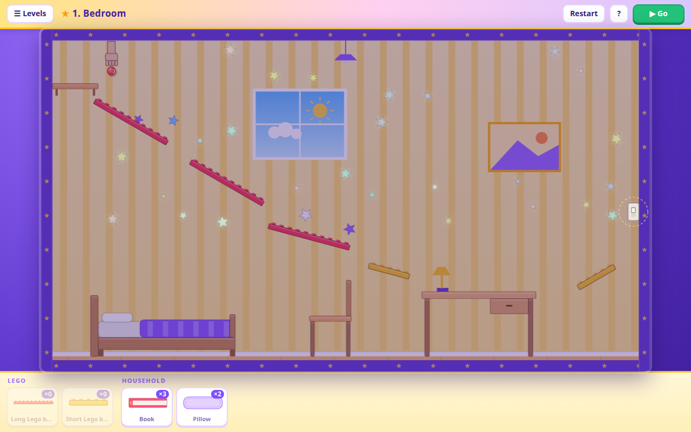

# Ball Track

Browser physics puzzle: build a path from household items so a bouncy ball hits the light switch.
Implements `full_spec.md` (v1 + v2): Bedroom, Apartment and House levels.

## Run

    python3 -m http.server
    # open http://localhost:8000/

No build step. Matter.js 0.19.0 is loaded from cdnjs. Add `?solution` to the URL to pre-place
each level's verified solution (dev aid).

## Controls

Drag items from the bottom panel · click an item for its toolbar (rotate, mirror ↔ / ↕, remove) ·
drag the round handle above a selected item to rotate (Shift: 1° steps) · right-click: rotate 15° ·
Q/E or wheel while dragging: rotate 15° · F: mirror left–right · V or Shift+F: mirror upside down ·
Delete or drag to panel: return · Space: Go/Reset · R: reset · drag background / arrows / WASD: pan ·
wheel: zoom. Beam and track ends snap together when dropped close to each other.

## Checking the levels

    curl -o /tmp/matter.min.js https://cdnjs.cloudflare.com/ajax/libs/matter-js/0.19.0/matter.min.js
    node tools/verify-levels.mjs /tmp/matter.min.js

Runs each level's stored solution headlessly and checks it is a legal placement that hits the switch.
